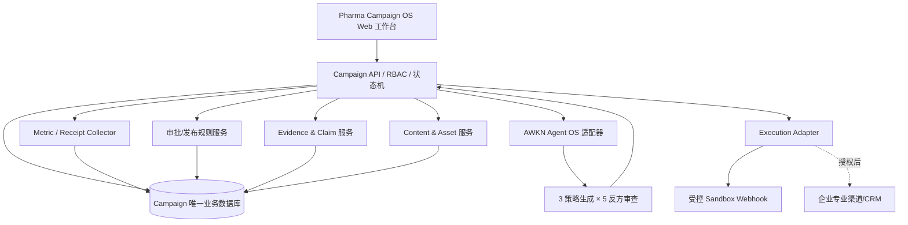

# Pharma Campaign OS｜全流程最小 MVP 产品需求文档（PRD）

> **版本**：v1.2 · 2026-10-10（三策略 × 五反方决策闭环修订）  
> **状态**：产品基线候选（待业务 Owner / 医学 / 法务 / 法规确认）  
> **命题**：信达生物制药（苏州）有限公司 · 赛道二「品牌营销｜创新药全链路智能营销系统」  
> **交付定位**：六段完整业务链路、一个 Campaign 主对象、一条可运行纵向闭环、六个业务工作台  
> **产品代号**：Pharma Campaign OS（暂定；公开展示前确认品牌）  
> **权威边界**：已只读核验部分 AWKN-Lab GitHub 默认分支 README、工程文档与 `marketing` 两份产品契约源码；未核验本地工作树、全部候选源码、当前 Exact HEAD、真实集成 Runtime、企业接口或药企数据授权。阶段性 `DEVELOPMENT_VERIFIED` 不代表真实平台可用。标注“拟接入”的能力不得声称已接通。

---

## 0. 一页决策摘要

### 0.1 产品目标

让品牌经理从一条经过核实的市场/医学信号出发，在同一平台内完成：

**信号发现 → 证据核验 → 战役策略 → 受众/预算/渠道编排 → 素材生成 → MLR 人审 → 授权执行 → 反馈归集 → 复盘再策划。**

MVP 对应一场小规模、可审计的**创新药合规专业教育战役**。AI 负责生成候选与辅助判断；确定性业务服务负责版本、权限、审批、执行、计量和审计。系统允许自动准备战役，并且必须尊重人类审批和渠道授权。

### 0.2 最小成功定义（Definition of MVP Done）

使用一个 `campaign_id`，一位市场 Owner 能够依次：

1. 导入一条可追溯信号和两份已授权/公开的资料，得到带证据的摘要；
2. **基于同一冻结 Brief 生成三套可区分的候选策略，并由市场、医学、竞争、财务、合规五位反方分别审查；形成 3×5=15 条独立评审记录、风险处置和一份可解释的方案比较**；
3. 品牌 Owner 选择或合成一套策略，保存含目标、受众规则、预算上限、渠道和 KPI 的 Plan 版本；
4. 生成至少两类素材草稿，其中含临床/药品表述的每条 Claim 均绑定出处；
5. 走完医学、法务、法规各一个可验证的人工审批节点，支持驳回与修改重提；
6. 冻结批准版本，经执行前许可校验，向**受控内测渠道**下发一次任务，取得真实 API 回执；
7. 采集带来源标志的实际测试事件，展示计划与结果，并产生可追溯的下一版优化建议。

**任何一环依靠静态动画伪装成运行结果都判为未完成。** 没有获批的外部专业渠道时，明确展示 `SANDBOX`，不会对医生、患者或公众真实发送。

### 0.3 非目标与暂缓项

- 暂不建设全国 HCP 主数据、真实患者画像、患者级转化归因、完整 CRM、复杂媒体采买与广告预算结算。
- 暂不自动向社交平台或互联网发布处方药广告；不收集个人病历或敏感健康数据。
- 暂不复刻 Veeva / IQVIA 的完整产品矩阵；不建设第二套通用 Agent 操作系统、审批引擎或营销数据仓库。
- 暂不承诺药企正式审批时间或全战役数月压缩至数小时。仅测量自动生成和系统内流转的真实耗时。
- 三策略为决策候选；模型推演不代表已证实的销量预测、临床判断或自动发布许可。五位反方承担质疑与证据检查，不能代替法定审查及企业 MLR。

## 1. 背景、依据与差异化假设

### 1.1 赛题对应要求

参赛海报要求跨越「用研、医学、市场、销售」断层，贯通舆情监测、医学数据检索、策略制定、内容生成、精准投放和效果回环。赛题希望大幅提高营销战役从发现到执行的速度。

### 1.2 参考产品所确定的底线

| 参考产品 | 已知公共产品能力（依据原有竞品报告） | 本 MVP 必须具备的对应业务能力 |
|---|---|---|
| IQVIA OneKey / OCE Digital / Next Best | 专业对象信息、分群、旅程、内容/渠道/时机建议、反馈 | 受众规则、任务建议、任务状态与反馈 |
| Veeva Campaign Manager | 目标人群、战役、营销/代表行动协调 | Campaign 主对象与编排清单 |
| Veeva PromoMats / Claims | 资产、医学断言、版本、MLR 与分发 | Claim→Evidence→Asset 血缘、不可变批准版本 |
| Veeva Approved Email / Engage | 获批素材的专业渠道执行记录 | 执行前授权检查及渠道 Receipt |
| Veeva Crossix | 高级效果衡量（主要美国市场） | 仅实现可核验的阶段指标，暂不推导处方/销量因果 |

**待验证差异化假设**：将医学证据、战役设计、内容审批、受控执行、事件反馈压在一个轻量 Campaign 对象内，降低跨岗位的任务等待与重复录入。该假设需要真实业务流程 A/B 或基线对照证明。

### 1.3 用户与任务

| 角色 | MVP 核心任务 | 权限边界 |
|---|---|---|
| 品牌/市场 Owner | 创建 Campaign、策略、预算、提交发布 | 无法独自完成 MLR 审批 |
| 医学审核员 | 核验 Claim 与适应症/证据 | 只签收医学范围 |
| 法务审核员 | 审核素材风险、引用与使用条款 | 只签收法务范围 |
| 法规审核员 | 审核药品性质、受众、地区、渠道、企业政策 | 有权阻断渠道与发布 |
| 市场运营 | 计划执行、检查回执、停用待发送任务 | 只能发布已签收范围与版本 |
| 管理员/审计员 | 设置测试渠道、查看日志、权限治理 | 无权冒签审批，不可改审计历史 |

最小开发可配置 6 个预置测试角色账号；演示允许切换身份，但审计需记录每个实际主体，生产禁用免登录角色切换。

## 2. 核心业务对象与业务语言

### 2.1 唯一主实体

`Campaign` 为营销战役唯一业务主真值：`campaign_id`、`tenant_id`、`brand_id`、`product_id`、`indication_id`、`territory`、`goal`、`owner_id`、`budget_cap`、`time_window`、`status`、`current_plan_version`、`mode`。

- `mode`: `DEMO` / `SANDBOX` / `ENTERPRISE`，默认 `SANDBOX`；该字段不等于执行授权。
- `source_class`: `PUBLIC` / `LICENSED` / `SYNTHETIC` / `SANDBOX_EVENT` / `ENTERPRISE_ACTUAL`；每条事实和事件均须标记。
- 外部平台 `journey_id`、`message_id`、`job_id` 只作为关联引用，不可成为另一份主战役状态。

### 2.2 最小实体字典

| 实体 | 最小字段 | 不变量 |
|---|---|---|
| `Signal` | id, campaign_id, source_uri, observed_at, title, content_hash, source_class, rights | 无来源不得变成“真实市场信号” |
| `Evidence` | id, document_hash, source_uri, published_at, edition, indication_id, excerpt_locator, verified_by, expiry_at | 每一条药品事实能追到文档与章节/页码 |
| `Claim` | id, text, evidence_ids, approved_scope, status, content_hash | 无证据/过期不可成为已批准医学表述 |
| `StrategyRun` | id, campaign_id, brief_hash, evidence_snapshot_hash, budget_cap, model_route, status, started_at, ended_at | 三个候选共享冻结输入；输入变化须启动新版 Run |
| `StrategyCandidate` | id, run_id, variant_key(A/B/C), hypothesis, audience_rule, channel_plan, budget_allocations, actions, kpis, assumptions, evidence_refs, confidence_label, version_hash | 三方案必须具备可检查的实质差异；全部维持 PROPOSED |
| `CriticReview` | id, candidate_id, critic_role, input_hash, model_run_id, status, verdict, severity, objections, evidence_refs, missing_evidence, revision_requests, trace_ref | 五角色独立评审；强阻断记录不可被加权分数覆盖 |
| `StrategyDecision` | id, campaign_id, run_id, selected_candidate_ids, rejected_reasons, unresolved_risks, owner_id, decision_at, decision_hash | 品牌 Owner 人工选择/组合并签收；复盘可回溯全部异议 |
| `CampaignPlan` | campaign_id, version, strategy_decision_id, objective, audience_rule, territory, budget_cap, channels, kpi_definitions, status | 未经决策签收不可从 StrategyCandidate 生成正式计划；计划版本不可原地覆盖审批快照 |
| `Asset` | id, campaign_id, asset_type, version, text_or_blob_hash, claim_ids, intended_audience, channel, state | 内容编辑产生新版；旧审批不自动迁移 |
| `Approval` | id, asset_version_hash, plan_version, reviewer_id, role, verdict, decided_at, reason, expiry | 与精确版本及范围绑定，禁止同人假冒多个角色 |
| `AudienceSegment` | id, source_class, inclusion_rule, exclusions, count, consent_basis, allowed_channel | 禁止使用未授权个人名单 |
| `DispatchJob` | id, campaign_id, package_hash, channel, segment_id, idempotency_key, state | 执行前再次核准批准、范围和渠道 |
| `DispatchReceipt` | id, job_id, provider_id, provider_event_id, status, timestamp, mode, raw_ref_hash | 真返回与模拟返回明确区分 |
| `MetricEvent` | id, campaign_id, metric, value, unit, observed_at, origin, source_class | 不准将合成触达记为真实成交或增长 |
| `AuditEvent` | id, actor, tenant_id, action, entity_id, before_hash, after_hash, occurred_at | 追加式记录；查得出责任和版本 |

**编码原则**：服务端生成 ID，所有变更请求携带 `tenant_id` 与权限上下文；数据表、任务、日志按 `tenant_id` 隔离。时间采用 UTC 存储，前端显示本地时间。

## 3. 六大页面与功能清单（P0）

> 六个一级入口共享 Campaign 页面顶部：产品/适应症、目标、负责人、状态、预算、待办、模式标记。采用桌面优先响应式 Web；移动端保证审批、预警和查看任务可用。

### P01｜战役总指挥台

**用户价值**：一眼看到这场战役处于什么状态、下一步由谁负责、当前风险在哪。

- MVP：新建/复制一场战役；战役列表；概览卡（阶段、预算上限、待处理审批、可执行任务、结果）；阶段时间轴；阻塞原因与点击穿透。
- 表单必填：产品、适应症、目标、Owner、区域、预算上限、周期、执行模式。
- 核心按钮：`创建战役`、`查看信号`、`进入下一阻塞任务`、`停止待执行任务`。
- 验收：刷新页面后 Campaign 和阶段不丢失；任何“异常”跳转到具体记录。

### P02｜信号与医学证据中心

- MVP：手工录入 1 条市场信号；上传/登记 ≥2 份允许使用的 PDF/文档；抽取摘要、章节与文献出处；去重提示；医学 Claim 核验记录。
- 最小自动化：信号入库后生成摘要与“待核问题”；证据查询返回原文定位及来源类型；未经验证内容显示 `UNVERIFIED`。
- 允许使用 Docling 解析文档，抽取表格数值须做人/程序一致性核对。
- 验收：点击任何关键结论能够看到原文出处；更换文档版本，相关 Claim 出现重新核验标记。

### P03｜策略与战役编排台

- MVP：对同一份冻结 Brief **并行生成恰好三套策略 A/B/C**，逐项填写目标假设、受众、渠道、预算、KPI、执行里程碑、主要风险和证据引用；五位反方分别审查三套策略，共形成 15 条结构化 CriticReview。品牌 Owner 可编辑、重跑审查、选定或组合方案，再形成待审批 Plan 版本。
- 人群只使用**合成/内测授权名单**；分群示例为“所在部门/专业领域/机构类型/区域”的合法来源标签，不做患者画像。
- “精准”定义为规则可解释的**目标群组 + 合适内容 + 合法渠道 + 指定时机**；不承诺患者级个性化。
- 每套策略自动输出最多 3 个优先行动（含 `reason` / `evidence_refs` / `owner` / `expected_metric` / `policy_status`），供人审后纳入统一战役待办。
- 页面采用三列对比：策略标签、投入区间、优先人群、渠道组合、行动路径、指标、证据缺口；右侧五位反方审查抽屉展示质疑、异议等级、证据和修正请求；下方显示人类选择理由及未解除风险。
- 验收：输入一致、三策略实质不同且各有五条完整异议记录；未解决的医学/合规硬阻断禁止转成可执行 Plan；修改预算/渠道产生新版并触发相关复审。

### P03.1｜三策略 × 五反方决策机制（P0 核心能力）

**触发**：证据中心已形成可审核的 Brief，包含目标、已批准适应症范围、区域、预算上限、可选合规渠道、可用受众来源、KPI 定义与证据列表。`brief_hash + evidence_snapshot_hash + policy_version` 用于冻结本次评议输入。

#### 三个差异化策略方向（案例为合规专业教育战役）

| 方案 | 增长假设 | 首选动作 | 资源侧重 | 可验证指标 | 主要未知 |
|---|---|---|---|---|---|
| A｜证据驱动的专业教育 | 已验证的医学信息传递效率有提升空间 | 形成证据主题包与专业教育内容计划 | 医学资料整理、合规内容制作 | 经批准的素材交付时效、专业教育活动参与指标 | 主题是否符合业务真实需求 |
| B｜关键问题专题活动 | 专业交流流程存在触达或理解障碍 | 聚焦一个高价值问题，设计学术活动与会后反馈 | 医学专家审阅、活动准备、运营跟进 | 已授权报名、参与率、反馈完成率 | 合法渠道资源与实际活动能力 |
| C｜小范围运营试点 | 部分区域的专业协同流程可先验证 | 选择一个授权区域做小规模流程试点 | 本地团队、任务执行、复盘测量 | 任务完成率、响应时间、审查返工率 | 区域资源与基线缺口 |

三个方向是**生成约束的起点**，并不预先判定胜者。缺少合法受众或渠道时应生成 `UNAVAILABLE` 说明；任何候选都不得自行补写未经证实的商业、临床或投放效果数字。预算是三种**备选方案分别计算**，不得把三个方案预算简单相加。

#### 五位反方的职责与输出

| 反方角色 | 核心攻击问题 | 最小结构化输出 | 阻断边界 |
|---|---|---|---|
| 市场反方 | 需求和受众价值是否成立？目标是否可测？ | 需求假设、受众偏差、KPI 盲点、待验证实验 | 关键业务前提缺失标记 `HOLD` |
| 医学反方 | 每个医学表述能否溯源，适应症及研究外推是否越界？ | 无依据 Claim、证据冲突、版本/范围问题 | `HARD_BLOCK`：涉及医学事实错误或关键证据缺失 |
| 竞争反方 | 三策略是否同质化？是否高估差异化或低估已有方案？ | 同质性分析、竞争替代、差异证据 | 提醒整改；不可假造竞争数据 |
| 财务反方 | 预算、成本、资源和实验收益假设是否自洽？ | 预算拆分、投入阈值、成本未知、止损条件 | 超 `budget_cap` 由确定性规则硬阻断 |
| 合规反方 | 内容、受众、渠道、数据用途、地域政策是否允许？ | 违规风险、适用范围、需人工确认规则 | `HARD_BLOCK`：违法或授权缺失的候选动作 |

**工作机制**：三套策略共享输入快照；五位反方读取策略后各自生成独立 `CriticReview`，记录具体异议、引用、置信边界、需补材料及整改动作。相互不同的意见全部保留，禁止由汇总 Agent 擅自删去少数反对意见。各角色可并行，但评审结果须独立归档。

**比较与决策**：允许配置权重作为决策辅助，默认按医学证据充分性、合规可执行性、业务价值、资源可行性和实验可衡量性解释性对比；未知值保留 `UNKNOWN`，**所有权重分数服从硬阻断判定**。系统可以建议采用 A、B、C 或经重评的组合。最终由品牌 Owner 签署 `StrategyDecision`，记录选项、反对意见、接受的风险、需要修改的动作以及理由。

**迭代**：任意候选的关键 Claim、受众、渠道、预算或证据快照改变时，标记旧 `CriticReview=STALE`，受影响方案重新提交五反方复审；已签的 `StrategyDecision` 不自动覆盖或继承正式计划/素材的 MLR 批准。未经人工决策不得进入正式执行链。

**Agent 合作边界**：复用 AWKN Agent OS 的并行席位、Grant、任务调用及 Receipt；复用 Forge 决策方案中的反方意见呈现、冲突识别和方案合成协议（需实际代码及 Exact SHA 核验）。五个角色是本平台的**职责配置**，无须另建五套运行时，也不意味着 Forge 的既有代码已经完成集成。不能用 AI 的 `PASS` 替代 MLR 三方实名审批。

### P04｜内容工厂

- MVP：依据已核实 Claim 生成两类内容：`专业教育邮件/内部测试邮件` 与 `学术活动邀请/培训资料`；带品牌素材结构；支持人工编辑、版本差异、引用列表及导出 HTML/PDF。
- 生成物默认 `DRAFT`；敏感医学句段旁展示 Claim 与证据索引；无支撑陈述高亮并进入阻塞列表。
- 设计编辑器：GrapesJS 作为可选嵌入组件；第一阶段文本模板可先实现同样的流程契约，禁止因 UI 编辑器延迟打断整条链路。
- 验收：一旦修改已提交/批准内容，即生成新版本，旧批准对新版无效。

### P05｜医学合规与渠道执行中心

- MVP：提交审核、医学→法务→法规顺序人审（可配置顺序但默认固定）、驳回/附理由/重提；显示审核人、时间、精确版本与批准范围。
- 发布包冻结：策略版本、Asset 哈希、Claim 版本、目标群组、区域、渠道、审批链、有效期、预算授权，计算 `package_hash`。
- 执行：先走**企业内部受控测试 HTTP/Webhook 收件端**，经平台 Adapter 真实下发并取回回执；可以另展示 `SIMULATED` 的外部专业旅程，但不得宣称真实发送。
- 关键控制：测试与生产凭证完全隔离；未配置企业合法合规渠道时 `ENTERPRISE` 开关保持禁用；发布由有权限的人确认。
- 验收：未审批、审批过期、跨受众、错渠道、超预算、版本修改后的旧批准，均被 API 层拒绝；执行返回 `job_id` 和 `receipt_id`。

### P06｜效果监测与复盘中心

- MVP：展示实际沙盒任务数量、成功/失败、回执时间、耗时、审批退回次数、来源明确的触达/反馈样例、预算计划与可观测支出（没有费用真值则标注不可用）。
- 指标过滤：`DEMO`、`SANDBOX`、`ENTERPRISE_ACTUAL`，默认不合并不同来源。
- 基于真实收集的工作流事件生成复盘建议，保存成 `Plan v2` 草稿；不得自动发布下一轮。
- 验收：复盘可追到上游事件 ID；清除模拟事件后相关模拟指标归零；重载后日志一致。

## 4. 全流程最小演示脚本（Golden Path）

**场景**：某创新药已获批适应症的“授权专业学术教育”活动。具体药品与医学内容在演示前取得适当使用授权；默认选用去标识化、公开可核资料，并标注仅用于系统功能演示。

| 序号 | 操作者 / 系统 | 可见动作 | 持久化产物 | 验收探针 |
|---|---|---|---|---|
| G01 | 市场 Owner | 创建活动战役，填写目标、预算和期间 | `Campaign` | 重新登录后仍可见 |
| G02 | 信号代理/人工 | 登记一条带来源的公开信息/市场假设 | `Signal` | 源链接、时间、哈希可见 |
| G03 | 医学人员/AI 辅助 | 导入文档，抽取并核验 Claim | `Evidence`, `Claim` | 点击断言显示出处与页码 |
| G04 | Agent OS + 五反方 + 市场 Owner | 生成 A/B/C 三方案，分别完成五反方评审，市场 Owner 选定/组合并签收 Plan v1 | `StrategyRun`、3 `StrategyCandidate`、15 `CriticReview`、`StrategyDecision`、`CampaignPlan` | 能查看全部异议；至少一个阻断→整改→复审；签收理由可回溯 |
| G05 | AI+编辑 | 生成两类素材，编辑并提交 | `Asset v1` | 所有发布 Claim 绑定证据 |
| G06 | 医学/法务/法规 | 至少一次驳回，然后修改重提并三方批准 | `Approval` 集合 | 精确哈希和审批人可核验 |
| G07 | 市场运营 | 冻结发布包，确认渠道/名单，触发受控沙盒任务 | `DispatchJob` | 旧版本/错误范围必拦截 |
| G08 | 测试渠道 Adapter | HTTP 实发到测试收件端、回传回执 | `DispatchReceipt` | 回执含 provider id、时间、状态 |
| G09 | 事件采集 | 接收测试点击/确认或运营回执事件 | `MetricEvent` | 来源为 `SANDBOX_EVENT` |
| G10 | 品牌经理 | 查看 KPI、阻塞和回顾建议，生成 Plan v2 草稿 | `Learning`, `Plan v2` | v2 没有越权自动发布 |

时间测量：独立记录 `signal_to_plan_draft`、`plan_to_submission`、`submission_to_approval`、`approval_to_dispatch`、`dispatch_to_receipt`。人工与监管审批等待时间不能归算为模型自动处理耗时。

## 5. 状态机、阻断策略及恢复

### 5.1 Campaign 主状态

```
DRAFT
  -> EVIDENCE_READY
  -> PLAN_READY
  -> ASSET_DRAFTED
  -> IN_REVIEW
  -> APPROVED
  -> SCHEDULED
  -> EXECUTING
  -> MEASURING
  -> REVIEWED

IN_REVIEW -- reject --> ASSET_DRAFTED
APPROVED/SCHEDULED -- invalidation --> NEEDS_REAPPROVAL
SCHEDULED/EXECUTING -- stop --> PAUSED
任一阶段存在不可恢复问题 --> BLOCKED（人工处理后回到上一步）
```

`Campaign.status` 是业务阶段聚合；资产状态与任务状态独立，避免“部分任务已完成、部分失败”时用一个阶段字段掩盖真相。

### 5.2 绝对门禁

1. **Evidence Gate**：涉及医学疗效、安全性及适应症的 Claim 具备核实来源、有效版次和范围。
2. **Audience & Channel Gate**：依据药品类别、司法辖区、受众资格、用途、同意/授权与具体渠道判断许可。中国处方药互联网广告传播须依法严格限制；内部 MLR 不代替依法要求的行政审查。
3. **Approval Gate**：每位有权审核者仅批准特定 `asset_version_hash`、`plan_version` 和批准范围；maker/checker 隔离。
4. **Publish Gate**：再次检查授权、审批有效期、素材哈希、预算、名单、频率和通道状态；拒绝“前端按钮绕行”及 API 重放。
5. **Receipt Gate**：任务使用幂等键，失败可限次重试；没有真实 Provider 返回，不生成 `DELIVERED`。
6. **Audit Gate**：状态变更与审查记录只追加不可篡改，附件引用使用内容哈希；审核者可复算关键过程。

### 5.3 失败、停用与撤回

- 任一审批被驳回：保存原因，阻止发布，编辑新版重新走审核。
- 证据撤回/过期或药品资料变更：受影响的待发任务自动 `PAUSED`，要求重新审核。
- 渠道超时：转 `RETRYABLE_FAILED`，限定次数重试，仍失败则 `FAILED` 并人工介入；每次重试与回调幂等。
- 用户停止：阻止所有待执行批次；已实际发出的消息只能发送下架/更正或后续处理任务，不能宣称物理撤销。
- 没有合法授权或真实接口：执行状态 `BLOCKED_NO_AUTHORIZATION`；不得偷偷降级为真实发放。

## 6. UI 信息架构与交互契约

建议左侧一级导航：**总指挥台 / 证据中心 / 策略编排 / 内容工厂 / 审批与执行 / 效果复盘**。

- 顶部全局栏：当前 Campaign、适应症、当前版本、 `SANDBOX` 标识、进度 0–6、任务告警。
- 中央画布：当前页面的可操作工作对象；右侧抽屉为 AI 建议、证据链、变更记录和差异对比。
- P03 专用视图：并排三张策略卡 + 五位反方评审矩阵（3×5）+ 异议明细 + 重新评审 + Owner 签收；明确展示 `HARD_BLOCK / HOLD / REVIEWED / STALE`，点击每条异议可跳转证据。
- 所有页面统一显示“下一动作”：由谁做、应完成什么、前置条件、超时警告、成功/失败回执。
- 危险动作（批准、启用真实渠道、发布、停止）采用权限校验 + 确认；无授权功能显示不可用理由。
- 列表状态从服务器读取；页面刷新/浏览器断开后工作流状态不应倒退。

**关键界面底线**：能查看业务真实对象和任务，不能以纯聊天界面替代战役工作台。移动端首版支持审批和进度查看；复杂策略编排以桌面端为准。

## 7. 系统架构与开源复用选型

### 7.1 结构图



### 7.2 COPY > ADAPTER > BUILD 决策（内部仓优先）

优先级固定：**已核实可复用的自有 Git 代码 → 自有系统 Port / Adapter → 合规可用的外部开源 → 仅对医药差异 BUILD**。复制行为必须经过 source SHA、许可证/归属、冲突检查、构建测试与业务门禁；不允许未经审计整仓搬迁。

| 功能 | 首选来源 | 默认裁决 | 进入 MVP 的条件 |
|---|---|---|---|
| 营销工作区/任务/反馈/结果/学习 | `AWKN-Lab/marketing` | COPY 可隔离产品原语；ADAPTER 对接 | 先完成代码差异/依赖盘点；不得直接复用营销助理的业务主模型 |
| 营销产品操作与幂等信封 | `marketing/lib/product-contract.ts`、`lib/ports.ts` | COPY/ADAPT | 扩展 Campaign 语义，保留 request_id、idempotency_key、稳定实体 Ack；现有 19 操作不冒充 Campaign API |
| 多智能体调度、Grant 与 Receipt | `AWKN-Lab/agent-os` | ADAPTER 优先，必要时 COPY 小原语 | 运行时合同与审批隔离；禁止再造 Agent Runtime |
| 医学资料来源/Claim/证据血缘 | `AWKN-Lab/AWKN-Memory-OS` + Docling | ADAPTER + 外部解析组件 | Claim 引用结构可用，但医学证据核验与 MLR 必须由独立医药规则/人员负责 |
| 数据源与第三方工具接入 | `AWKN-Lab/awkn-mcp` | ADAPTER | 权限、健康、合法取数、真实回执通过；不创建第二套 Gateway |
| UI 令牌、通知、任务状态等通用面 | `AWKN-Lab/UI` | COPY 选定通用组件/Theme Adapter | 读当前组件源码及构建证据；其 v0.4 全量运行验收尚未完成 |
| 三策略与五反方决策机制 | `AWKN-Lab/agent-os` + `AWKN-Lab/Forge` + `marketing` | ADAPTER / 选择性 COPY | 必须完成三个候选、十五条异议、Owner 签收与重评；保留五角色独立记录，严禁让 AI 替代 MLR |
| 决策反方与证据缺口呈现 | `AWKN-Lab/Forge` | ADAPTER/小原语 COPY | 只吸收 provenance、conflict、dissent 等通用方法；不复制关系、个人分身与枢密院业务数据 |
| 医药 Campaign/Plan/MLR/Package/发布状态 | Pharma Campaign OS 自研 | BUILD | Campaign 唯一业务 Authority；精确批准版本和负例门禁 |
| 专业内容编辑 | GrapesJS；可先用 `marketing` 已有 Artifact UI 思路 | COPY 候选 | 新编辑器不阻断纵向闭环 |
| 外部营销旅程/名单触达 | Dittofeed | P1 ADAPTER 候选 | 先用内测 Sandbox Adapter；社区版与商用模块许可须核查 |
| 自动化连接与 BPMN | 已有 AWKN 能力；Activepieces / Flowable 备选 | P1 ADAPTER | 确有功能缺口才新增，不形成双调度或双审批真值 |
| AI 追踪与报表 | Agent OS 现有观测 + Campaign DB 聚合 | ADAPTER / BUILD 最小 | Langfuse、PostHog、Superset 按需入 P1，不影响业务回执 |

**许可证提醒**：Dittofeed 社区核心与商业嵌入/白标/多租户的授权边界不同；Activepieces 的 EE 功能单独核实；GrapesJS BSD-3-Clause；Docling MIT；Flowable Apache-2.0。引入前逐一复核当前仓库 LICENSE、依赖许可证、实际提交版本和运行成本。Mautic（GPL）与 n8n（使用限制）不作为首批复制来源。

**同一大组件一个 PR**：若已有同一组件工作分支/PR，继续原分支；新的独立大组件方可另开 PR。合流必须先验 exact SHA、运行结果、门禁收据和 Owner 授权。

### 7.2.1 自有 Git 仓库能力清单（默认分支只读取证，待 Exact SHA 与 Runtime Gate）

下表中的“仓库已经有”仅表示公开给当前连接器的代码/文档确实存在；**不表示 Pharma Campaign OS 已吸收、联调通过、已部署或已获生产授权**。

| 来源仓 | 已核实的能力及证据入口 | Pharma 使用位置 | 复用裁决 | 尚缺验收 |
|---|---|---|---|---|
| [`AWKN-Lab/marketing`](https://github.com/AWKN-Lab/marketing) | [`lib/product-contract.ts`](https://github.com/AWKN-Lab/marketing/blob/main/lib/product-contract.ts) 19 个营销操作及 Request/Response；[`lib/ports.ts`](https://github.com/AWKN-Lab/marketing/blob/main/lib/ports.ts) Workspace、Material、Task、Feedback、Outcome、Evolution、Learning Port；[`docs/P3-EXECUTION-BASELINE.md`](https://github.com/AWKN-Lab/marketing/blob/main/docs/P3-EXECUTION-BASELINE.md) 表明任务执行冲突处理；P4 学习回路 | P01、P02、P03、P06 的通用任务与数据交互 | **P0 第一供体**：COPY 可隔离组件，业务合同用 ADAPTER | 本地源码/依赖检查；P6 真实 AWKN 接线；服务端持久化/多租户；医疗语义重新建模 |
| [`AWKN-Lab/agent-os`](https://github.com/AWKN-Lab/agent-os) | README 记录 Agent 调度、工具调用、Grant/审批、OTel 与 Receipt；具体源码尚未逐路径审查 | **三策略生成 × 五反方并行评议**、任务执行、风险审查接线 | ADAPTER | Exact SHA、三个候选/十五个独立评审、并行任务完整性及失败恢复；不能用 Agent 的操作同意代替 MLR 审批 |
| [`AWKN-Lab/AWKN-Memory-OS`](https://github.com/AWKN-Lab/AWKN-Memory-OS) | README/PROJECT_STATUS：Evidence→Claim→Lineage、Context、CAS、Receipt、权限与 SDK | 医学文献溯源、证据冲突、经验反馈 | ADAPTER | 来源使用权、文献页码、医学复核；正式发布的 MLR 记录仍由 Campaign 持有 |
| [`AWKN-Lab/awkn-mcp`](https://github.com/AWKN-Lab/awkn-mcp) | README：Source/Connector/Transport/Health/Access；[`docs/source-acquisition-contract-v1.md`](https://github.com/AWKN-Lab/awkn-mcp/blob/main/docs/source-acquisition-contract-v1.md) 入口 | 舆情合法取数、内部 Webhook、外部系统接线 | ADAPTER | 已安装≠可调用；实际授权、健康、内容获取及回执分门核验 |
| [`AWKN-Lab/UI`](https://github.com/AWKN-Lab/UI) | README：Design Tokens、React Shell、Run Capsule、通知、KPI/Grid 等；v0.4 当前标明 Full Runtime Visual 未验证 | 六页 Shell、统一任务/状态体验 | 选择性 COPY | 当前文件路径、导出 API、许可证、运行与多尺寸视觉验收 |
| [`AWKN-Lab/Forge`](https://github.com/AWKN-Lab/Forge) | [`STANDALONE-ARCHITECTURE`](https://github.com/AWKN-Lab/Forge/blob/main/docs/shumiyuan/engineering/STANDALONE-ARCHITECTURE.md)：provenance、conflict、dissent、decision synthesis | P03 五反方审查、少数异议保留、方案合成；P06 复盘 | ADAPTER；必要时复制纯函数 | 校验独立评审/冲突汇总/不同意见保全；禁止带入私有业务数据库 |
| `全球派 / GOPAI / 其他营销资产` | 既往项目经验存在；**本轮未完成目标仓精确代码与授权核验** | P03 经营任务、P05 执行、P06 效果 | BACKLOG 候选 | 先确认仓库、分支、source SHA、实际模块及权限，不计入 P0 节省工期 |

**关键反例**：`marketing/docs/PRD.md` 将 Campaign Automation、群发、投放平台列为其 V1 非目标，因此通用营销助理可复用 Task/Workspace/Feedback/Evolution，不能声称已有医药 Campaign 编排、MLR 或精准投放成品。其 README 的 P0–P5 `DEVELOPMENT_VERIFIED` 只覆盖研发门；P6 真平台接线仍是 Next、P7 业务验收是 Planned。新增医药 Campaign Domain 必须保持独立。

### 7.2.2 最小吸收单元与版本治理

每条候选能力登记以下字段，放在 Pharma 仓库的组件吸收记录中：

```text
source_repo / source_ref / source_exact_sha / source_paths / blob_hashes
license_or_internal_ownership / destination_paths / copy_or_adapter / business_delta
canonical_owner / read_write_boundary / source_contract / acceptance_tests
runtime_receipt / accepted_exact_sha / rollback_plan / status
```

复制顺序：**确认供体源 → 对照目标组件合同 → 只取满足合同的路径 → 改造差异 → 跑静态/契约/真服务测试 → 留 Receipt → Owner 决策并线**。只读查看 GitHub 不构成合并、复制、推送、部署授权。每个大组件沿用唯一在途 PR，不对同一组件新开并行分支。

吸收过程中统一不变量：

1. **Campaign 主真值唯一**：`marketing.Workspace` 是可复用容器或上下文；`campaign_id`、批准状态、发布包、战役预算的唯一写入者仍为本产品的 Campaign Service。
2. **授权层级区分**：Agent OS Grant 只控制工具/运行权限；医学、法务、法规批准由 Campaign 的实名 MLR 流程持有；具备 Agent 工具调用能力不代表可以发布。
3. **证据分权**：Memory OS Claim 可用于检索与血缘索引；药品声明的批准版本、适应症适配和过期阻断由医药 Domain 管辖。
4. **回执不得混用**：Agent 完成、MCP HTTP 200、`marketing` Task 结果、渠道发货/送达、用户参与和业务 Outcome 是不同事件。仅真实授权 Provider 的签收能写实际渠道执行状态。
5. **历史产品不受侵入**：默认以目标仓最小复制或独立 Adapter 读取；不修改原供体数据库、身份语义、Owner 和产品 PRD。发现版本冲突先停止并重新盘点。

### 7.2.3 MVP 开发起步顺序调整

- **R0（必做）**：对 `marketing` 的 `product-contract / ports / workspace / task-execution / feedback / learning` 做逐文件兼容审计；记录准确源 SHA 与依赖许可证；核实在现有 PRD 目标中可保持独立。
- **R1（先复用）**：移植通用 UI、任务、反馈、幂等操作信封和测试；建立完整的 `CampaignAdapter`，确保向内只写 `campaign_id` 的产品主业务状态。
- **R2（策略决策层）**：在 Campaign Domain 中新增 `StrategyRun / StrategyCandidate / CriticReview / StrategyDecision`，以 Agent OS 并行调度 3×5 评审；Forge 只复用已审决策原语。增加人类选案及复审门。
- **R3（医药增量）**：新增 Evidence/Claim 监管规则、MLR 精确批准范围、发布包状态、受控 Sandbox Webhook 与事件回流。
- **R4（跨仓整合）**：Agent OS、Memory OS、MCP 真服务接线；每个失败/撤权场景能停止且有 Receipt；未接通的能力保持 `UNVERIFIED`。
- **R5（评审交付）**：对 G01–G10、AT01–AT20 及所有吸收记录绑定 source/build/runtime Exact SHA，运行对照复验。

### 7.3 数据与 AI 边界

- AI 输出只作为 `PROPOSED`：三套候选策略、五反方意见、Claim 摘要、内容、改进建议都由人审或规则确认后成为正式业务数据。反方评议不授予发布权限。
- AI 服务读入资料必须受访问策略控制；未经同意不得向第三方模型发送内部机密、个人信息或患者敏感数据。
- 系统不能使用伪造文献、虚构临床数字；引用定位失败则阻止正式内容发布。
- 内部记忆平台可以保存检索索引与可追溯引用；正式审批、发布和战役状态由 Campaign DB 持有，防止多套真值。

## 8. 关键接口契约（首版）

以下端点为建议设计，实际路径在读取现有代码/合约后确定；所有写入操作需认证、租户验证、幂等或乐观并发控制、审计。

| 方法与候选路径 | 作用 | 关键成功输出 |
|---|---|---|
| `POST /campaigns` | 创建战役 | `campaign_id`, `status` |
| `POST /campaigns/{id}/signals` | 录入信号 | `signal_id`, `source_class` |
| `POST /evidence/import` | 导入并处理材料 | `evidence_id`, `parse_status`, `hash` |
| `POST /campaigns/{id}/strategy-runs` | 以冻结 Brief 启动三方案推演 | `run_id`, `brief_hash`, `strategy_count=3`, `status` |
| `GET /strategy-runs/{run_id}` | 查看三候选及五反方审查 | `candidates[3]`, `critic_reviews[15]`, `missing_reviews`, `blockers` |
| `POST /strategy-runs/{run_id}/reconsider` | 针对修改后的方案发起重评 | `revision`, `stale_reviews`, `new_review_ids` |
| `POST /campaigns/{id}/strategy-decisions` | 品牌 Owner 选择/组合并签收 | `decision_id`, `selected_candidate_ids`, `unresolved_risks`, `decision_hash` |
| `POST /campaigns/{id}/plans` | 绑定签收的 StrategyDecision 保存 Plan 版本 | `plan_version`, `version_hash`, `strategy_decision_id` |
| `POST /campaigns/{id}/assets` | 草拟素材并锁定引用 | `asset_id`, `asset_version`, `claim_refs` |
| `POST /assets/{id}/review` | 人工审批节点 | `approval_id`, `reviewer_role`, `verdict` |
| `POST /campaigns/{id}/packages` | 生成不可变发布包 | `package_id`, `package_hash`, `gates` |
| `POST /packages/{id}/dispatch` | 校验并授权执行 | `job_id`, `state`, `idempotency_key` |
| `POST /channels/{id}/receipts` | 受信回执采集 | `receipt_id`, `provider_event_id`, `mode` |
| `GET /campaigns/{id}/metrics` | 归集分来源指标 | `source_class`, `values`, `window` |
| `POST /campaigns/{id}/revisions` | 根据复盘创建候选下一版 | `plan_version`, `status=DRAFT` |
| `GET /campaigns/{id}/audit` | 查看事件链及哈希 | `event_ids`, `actor`, `prev/next_hash` |

所有 `dispatch` 需使用 `Idempotency-Key`，服务端去重并校验一致 payload。回执采用可信签名或私有可信连接，至少防止任意公网伪造成功。外部结果带 `provider`, `provider_reference`, `received_at`, `channel_mode`。`200` API 接受只代表任务已受理，不能冒充送达或互动。

### 8.1 示例发布包（示意，禁止直接用于生产）

```json
{
  "campaign_id": "cmp_demo_001",
  "plan_version": 1,
  "asset_id": "asset_demo_001",
  "asset_version": 2,
  "asset_hash": "sha256:<calculated-on-server>",
  "audience_segment_id": "segment_internal_test",
  "channel": "INTERNAL_SANDBOX_WEBHOOK",
  "territory": "CN",
  "review_scope": ["MEDICAL", "LEGAL", "REGULATORY"],
  "status": "APPROVED_FOR_SANDBOX_ONLY",
  "package_hash": "sha256:<calculated-on-server>"
}
```

## 9. 质量、性能和治理非功能需求

| NFR | 最小要求/验收方法 |
|---|---|
| 数据持久化 | 跨进程重启之后可读取 Campaign、审查、任务及回执；禁止演示仅用前端 localStorage |
| 角色隔离 | 未授权访问返回 403/不可见；跨 `tenant_id` 请求返回拒绝且不泄露数据 |
| 审批不可绕过 | 直接调用 API、重放旧包、修改已批内容都不得成功派发 |
| 可用性 | 测试环境能够完整完成 G01–G10；断网/渠道超时可展示失败与恢复 |
| 性能建议目标 | 1 场战役、≤1000 条测试事件时页面 95% 请求 ≤2s（不计 LLM）；生成等待显示明确状态；这是目标而非现状 |
| 成本 | 每场战役显示模型调用次数及已知计算成本；外部渠道费用未知时显示“未接入/未知” |
| 追溯 | Claim→Evidence→Asset→Approval→Package→Dispatch→Receipt→Metric 可沿链单向/反向查询 |
| 环境隔离 | 开发/演示/企业环境分密钥、分数据库或命名空间；线上通道默认关闭 |
| 合规保留 | 定义数据用途、授权来源、保留/删除责任，具体期限待企业制度确认；审计例外留存需依法评估 |
| 视觉可信 | 演示、合成、沙盒、企业实际四类数据显示显式水印/标签，不得混淆 |
| 安全治理 | 服务端 RBAC、CSRF/输入校验、速率限制、签名回执、密钥不入库与源码、日志脱敏 |

## 10. 产品验收条款（必须自动化）

| 编号 | 验收测试 | PASS 判定 | 重要等级 |
|---|---|---|---|
| AT01 | 创建/编辑/读取战役 | 每次写入后数据库真实持久化，重启可读 | P0 |
| AT02 | 证据溯源 | 发布相关的 Claim 100% 有核实 Evidence 和章节定位 | P0 |
| AT03 | 计划/素材版本 | v1 与 v2 hash 可区别，旧版本不可被覆盖 | P0 |
| AT04 | MLR 人审 | 三角色审查和一次驳回/重提完成，签名与身份匹配 | P0 |
| AT05 | 未批准强拦截 | 直接调用派发接口返回明确拒绝，无渠道调用 | P0 |
| AT06 | 篡改/过期强拦截 | 资产 hash 变化、审批过期、错范围均拒绝派发 | P0 |
| AT07 | 授权沙盒投递 | 发往封闭测试 Webhook，收到真实回执，标记 SANDBOX | P0 |
| AT08 | 幂等与失败 | 同一幂等键不重复发送；超时/失败留痕；停止后不再新发 | P0 |
| AT09 | 源数据诚实 | 模拟指标与真实指标隔离，删除模拟后真实指标不变 | P0 |
| AT10 | 下一轮复盘 | 基于事件产生 Plan v2 草案，审批不继承 | P0 |
| AT11 | 账号隔离 | 租户 A 无法读写租户 B 任意资产、回执或审计 | P0 |
| AT12 | 一键全链回溯 | 从 Dashboard 到所有核心业务对象/回执不缺 ID | P0 |
| AT13 | 未授权企业通道 | 未配置合法渠道和业务许可时 ENTERPRISE 执行绝对阻塞 | P0 |
| AT14 | 演示源码与产物绑定 | 页面、API、测试指纹都绑定同一 source/build SHA；旧构建不可报新提交 PASS | P0 |
| AT15 | 三方案生成完整性 | 同一 `brief_hash` 下恰好 3 套候选，A/B/C 在行动路径/受众/预算至少两项有实质差异 | P0 |
| AT16 | 五位独立反方 | 每套策略都有市场/医学/竞争/财务/合规各一条独立记录，合计 15 条；缺失、重复角色、伪完成均失败 | P0 |
| AT17 | 反方证据与少数异议 | 关键异议带证据或 `MISSING_EVIDENCE`；冲突/反对意见在汇总与 UI 中完整保留 | P0 |
| AT18 | 硬阻断与复审 | 医学错误、违规渠道、超预算任一情形均阻止相应方案进入正式 Plan；修改后相关评议变 STALE 并重跑 | P0 |
| AT19 | Owner 决策留痕 | 未签收的候选不能形成可执行 Plan；选择或组合方案须记录 owner、理由、采纳/驳回异议及版本 | P0 |
| AT20 | 反方与正式审批隔离 | 五位 AI 全部通过也无法签发 MLR 或绕过发布门；MLR 驳回仍能阻断执行 | P0 |

发布门禁：`CODE_GATE`（类型、lint、单位测试）+ `CONTRACT_GATE`（状态/契约/安全）+ `RUNTIME_GATE`（真服务、真持久化、受控通道）+ `BUSINESS_GATE`（G01–G10 与 P0 验收）+ `RECEIPT_GATE`（ exact SHA、构建指纹、运行模式、样本来源和操作者）。各门独立判定；代码测试成功不能自动宣布业务验收成功。

## 11. 最小工程拆解：一个大组件一个 PR

建议在 fresh-read 当前代码后建立工程映射。以下为逻辑交付单元，不自动授权开新分支：

| 组件 | P0 交付 | 依赖 | 验收证据 |
|---|---|---|---|
| C01 战役主控 | Campaign DB、状态机、RBAC、统一工作台骨架 | 无 | AT01/11/12 |
| C02 证据中心 | Signal/Evidence/Claim、导入解析与引用 | C01 | AT02 |
| C03 策略内容 | **三策略 × 五反方**、`StrategyRun/Candidate/CriticReview/Decision`、Owner 选择、Plan/Asset 版本、最小模板编辑 | C01/C02 | AT03、AT15–20 |
| C04 MLR 与发布包 | 人审、规则门、不可变版本、冻结包 | C01–C03 | AT04–06/13 |
| C05 执行与回执 | 沙盒 Adapter、任务幂等、失败/停止、来源区分 | C04 | AT07/08 |
| C06 指标与复盘 | 来源隔离、KPI 看板、Plan v2 | C05 | AT09/10 |
| C07 纵向验收 | 3×5 策略决策 + 全链测试、构建指纹、回执归档、演示证据 | C01–C06 | AT12/14/15–20、Golden Path |

C01–C06 每个大组件至多一个未关闭 PR；C07 作为独立跨组件集成/验收线，仅对测试、环境和集成契约写入，避免与开发组件争抢同一生产文件。若现有分支已经存在，则在既有分支上收口。

### 11.1 推荐交付顺序

- **D0（事实盘点）**：已确认 `AWKN-Lab/marketing` 为首选产品供体，已读其产品操作与 Port 源码；其余来源只读文档的能力需要逐路径审计。第一阶段继续盘点当前 Exact HEAD、本地工作树、部署/验证状态，并生成 `COPY / ADAPTER / BUILD` 与许可证差异表。无完整代码真值不得直接承诺可复用比例。
- **D1（竖切骨架）**：C01 和最小页面，形成实际数据库记录与状态机。
- **D2（证据+三策略决策）**：C02、C03，完成三套差异策略、十五次独立反方审查、一次硬阻断返工与 Owner 选案，并生成两种素材。
- **D3（审批+执行）**：C04、C05，先证明未授权拒绝，再证明合法测试渠道成功。
- **D4（指标+验收）**：C06、C07，完成 G01–G10、20 项验收与证据回执。

**工期估算**：若当前 Web/API/账号/DB/Agent 基础设施可复用，单支小团队可能在 10–14 个工作日内完成受控演示；这是条件式估算，待现有代码与人员确认后重排。不得把估算写成实际完成记录。

## 12. 演示交付包与结果边界

一场演示必须交付：

1. **可操作平台**：6 页 + 一个固定战役 + 真实 API/DB 连接。
2. **演示数据包**：信号、证据、获批适应症信息、合成测试受众、预置策略与素材，逐条标记来源和许可。
3. **业务回执包**：`campaign_receipt.json` 包含 `campaign_id`、`source_sha`、`build_sha`、`mode`、`evidence_hashes`、`strategy_run_id`、`candidate_hashes`、`critic_review_ids`、`strategy_decision_id`、`plan_version`、`approvals`、`package_hash`、`dispatch_receipt_ids`、`metric_event_ids`、`golden_path_status`。
4. **可重放验收**：一条命令启动服务和数据库，执行 G01–G10 和 AT01–AT20；测试账号、密钥和企业数据严格隔离。
5. **讲述口径**：演示证明跨部门流程与技术连接；真实业务效果、正式监管批准和授权营销渠道单独列“待验证/未接入”。

### 12.1 可量化成功指标

- 平台功能成功：20/20 P0 验收全通过；G01–G10 10/10 真服务完成。
- 三策略与五反方：3/3 候选 + 15/15 结构化评议 + 1 份 Owner 签收 + 至少 1 次硬阻断及整改复审，均有真实业务回执。
- 证据完整度：100% 对外素材医学 Claim 能回溯有效来源；不存在无批准对外任务。
- 投递真实性：100% 已报告的沙盒成功来自真实 Adapter 回执；企业真实成功只能引用企业渠道的独立回执。
- 体验效率：记录每个阶段耗时、手工任务数、审批退回数和无效生成数；改善幅度待完成同任务基线对照后公布。
- 测试无越权：越权租户、过期审批、素材篡改、渠道权限缺失四类负例全部失败关闭。

## 13. 风险登记与待确认决策

| 风险 | 早期征兆 | 处置 |
|---|---|---|
| 数据授权缺失 | 无法提供真实 HCP 与营销系统数据 | 使用合成名单+企业内部测试渠道，清晰标示 |
| 医学准确性 | 资料解析错误、Claim 与原文不一致 | 阻断正式发布、审核员复核、保留定位 |
| 法规/渠道适配 | 处方药面向公众宣传等情形 | Gate 默认拒绝，法规团队具体审核 |
| 新引入服务过多 | Dittofeed、Flowable、Activepieces 同时展开 | 先现有能力和简单确定性服务；一个场景验证通过再引入 |
| 双调度与双真值 | 多个系统同时修改战役状态 | Campaign DB 唯一 Owner；外围工具仅回执 |
| 伪闭环 Demo | API 只回固定成功、模拟充当真发 | 黑盒真实测试接收器 + 签名回执 + 模式隔离 |
| 三策略伪差异 | 三份策略只有标题不同、共享同一行动计划 | 保证独立版本、策略差异断言及人工可比证据 |
| 五反方虚假共识 | 五席简单复述结论、少数异议被汇总隐藏 | 五角色结构化审查、15 条独立 Receipt、反方驳回/阻断测试 |
| 工程并发冲突 | 多智能体同改组件或分支 | 一个大组件一个 PR，同目标单 Writer 与 Owner 合流 |

**待业务 Owner 给出答案的四项关键问题**：

1. 是否允许选一款已上市创新药（含具体适应症）用于公开参赛 Demo？哪些宣传/教育资料可用？
2. 信达是否可提供匿名化的 MLR 流程与审查标准？企业级发布是否另有必须取得的行政审查？
3. 是否可提供一个测试 HCP 专业渠道、内部审批平台或 CRM 沙盒账号？若无，按本文件封闭测试渠道交付。
4. 评审衡量是全链运行、审批合规、交互体验还是企业系统实际接通？前三项可先完成，第四项需协作授权。

## 14. 参考与引用

**项目已有报告**：

- 《pharma-campaign-os-review.md》（2026-10-10）：赛题需求、错误复盘、产品边界。
- 《pharma-campaign-oss-competitive-research-20261010.md》（2026-10-10）：IQVIA / Veeva 矩阵及开源项目选型。上述报告只核查公开资料，尚未做企业试用与开源仓运行验收。

**已核验内部 Git 供体入口（默认分支，只读；部署状态仍待 Runtime Gate）**：

- `AWKN-Lab/marketing`：https://github.com/AWKN-Lab/marketing/blob/main/README.md；https://github.com/AWKN-Lab/marketing/blob/main/lib/product-contract.ts；https://github.com/AWKN-Lab/marketing/blob/main/lib/ports.ts；https://github.com/AWKN-Lab/marketing/blob/main/docs/ENGINEERING.md。
- `AWKN-Lab/agent-os`：https://github.com/AWKN-Lab/agent-os/blob/master/README.md。
- `AWKN-Lab/AWKN-Memory-OS`：https://github.com/AWKN-Lab/AWKN-Memory-OS/blob/master/README.md；https://github.com/AWKN-Lab/AWKN-Memory-OS/blob/master/PROJECT_STATUS.md。
- `AWKN-Lab/awkn-mcp`：https://github.com/AWKN-Lab/awkn-mcp/blob/main/README.md。
- `AWKN-Lab/UI`：https://github.com/AWKN-Lab/UI/blob/main/README.md。
- `AWKN-Lab/Forge`：https://github.com/AWKN-Lab/Forge/blob/main/docs/shumiyuan/engineering/STANDALONE-ARCHITECTURE.md。

**供应商产品资料**：

- IQVIA Next Best Action：https://www.iqvia.com/solutions/commercialization/commercial-analytics/orchestrated-analytics/next-best
- IQVIA OneKey：https://www.iqvia.com/solutions/commercialization/data-and-information-management/onekey
- Veeva Campaign Manager：https://www.veeva.com/products/crm-suite/campaign-manager/
- Veeva PromoMats：https://www.veeva.com/products/veeva-promomats/
- Veeva PromoMats MLR Review：https://www.veeva.com/products/veeva-promomats/mlr-review/
- Veeva Approved Email：https://www.veeva.com/products/crm-suite/approved-email/

**候选开源仓（需 fresh-read License 与版本）**：

- Dittofeed：https://github.com/dittofeed/dittofeed
- Docling：https://github.com/docling-project/docling
- GrapesJS：https://github.com/GrapesJS/grapesjs
- Activepieces：https://github.com/activepieces/activepieces
- Flowable：https://github.com/flowable/flowable-engine

**法规初步参考**：

- 国家市场监督管理总局《互联网广告管理办法》：https://www.samr.gov.cn/zw/zfxxgk/fdzdgknr/fgs/art/2023/art_d93a579afd45413e8576e4623fab348f.html

---

## 版本变更摘要（v1.0 → v1.1）

- 补充内部 Git 供体优先级；`marketing` 为优先吸收的产品层来源。
- 明确已审源码和仅有 README/文档事实之间的证据区别；P0–P5 开发验证与 P6/P7 未闭合边界。
- 冻结 `Campaign`、MLR、医药 Claim 授权、DispatchReceipt 的唯一数据主权；按单元复制，避免整仓覆盖及双状态。
- 将外部 Dittofeed、Activepieces、Flowable 降为有条件候选，先验证内部能力是否覆盖。
- 不改变原有 G01–G10、AT01–AT14 的产品验收判据；实施前必须绑定 Exact SHA / Runtime Receipt。

## 版本变更摘要（v1.1 → v1.2）

- 将 P03 从“至少两套建议”升级为**三套差异化策略 × 五位独立反方**，覆盖冻结输入、15 条评议、反对意见、硬阻断、策略修订、Owner 签收与复审。
- 新增四个业务实体 `StrategyRun / StrategyCandidate / CriticReview / StrategyDecision`，通过 `strategy_decision_id` 挂接正式 `CampaignPlan`，保留唯一 Campaign 主真值。
- G04 扩展为完整 3×5 演示环节；新增四个策略相关 API；AT15–AT20 扩展测试集合至 20 项；不新增大组件或第二套 Agent OS。
- 保持医学、法务、法规 MLR 人工审批独立存在；所有评分从属硬性政策校验，策略智能体没有发布权。
- 工程估算和运行状态未据此升级；代码移植、Exact SHA、运行时集成与正式渠道授权仍待逐项验证。

## 最终 MVP 验收决议

**只有同一场 Campaign 能真实走完包含“三策略 × 五反方 × Owner 签收”的 G01–G10、AT01–AT20 全部通过，审批与执行不可绕过，审计链可信，并显式隔离模拟与真实数据，才达到“完整战役最小 MVP”的工程准入条件。** 企业外部真实营销上线另需数据授权、合规审批、运营验证及部署授权。