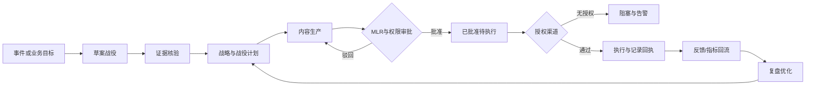

# 创意宇宙深度复盘｜信达生物创新药全链路营销战役平台

**版本**：v1.0 · 2026-10-10  
**研究范围**：用户提供的赛题海报「命题二：品牌营销｜创新药全链路智能营销系统」、公开竞争产品与法规资料  
**状态**：战略与产品架构建议；尚未取得信达生物内部需求、业务数据、真实授权渠道或技术接口。  
**边界**：「创意宇宙」仅用作思考和决策方法；参赛产品及模块采用独立命名。

## 0. 裁决摘要

- **赛道**：维持命题二，理由调整为「端到端业务闭环与平台交付」，撤销「只做战略推演智能体」的建议。
- **定位**：`Pharma Campaign OS`，以**营销战役 Campaign**为一级业务对象的创新药全链路智能营销战役平台。
- **主体验**：一位品牌经理可以创建一场战役，汇聚实时/准实时信号，完成证据核对、策略、任务、内容、合规审核、渠道执行与效果复盘。
- **AI 的角色**：在各工作节点提供分析、生成、质检、任务调度、实验建议。业务状态、审批、记录、审计和实际投放应由确定性平台服务承担。
- **参赛最低合格演示**：一条纵向打通的战役链路，真实状态流转和可追溯回执；未接通的外部渠道明确标注模拟。不能用多个聊天窗口代替运营平台。
- **最高风险**：医疗合规、客户数据与渠道授权、审批责任、不能从模拟反馈冒充真实增长结果。

## 1. 赛题原文重读

海报中命题二标题：**「品牌营销｜创新药全链路智能营销系统」**。关键要求原文可归纳为：

> 聚焦创新药品牌营销的快速响应与自动化闭环。传统营销链路存在「用研—医学—市场—销售」层层断节，响应以月为单位；系统需打通舆情监测、医学数据检索、策略制定、内容生成、精准投放与效果回环，自动吸收信号、自动做出反应，把过去数百人、半年完成的营销战役压缩到几小时内自动完成。

### 原题拆出的六条不可删业务要求

1. **跨部门**：用研、医学、市场、销售应共享战役事实、流程状态和责任边界。
2. **全链路**：输入、决策、生产、交付、执行、监测都在一个战役里闭合。
3. **快速响应**：重要信号触发复核、任务与行动；需要可衡量的耗时改进。
4. **真实执行**：至少存在能被演示和验证的触达/分发/内部交付动作。
5. **自动反馈**：执行数据回流，触发策略调整、内容更新或停止。
6. **医药治理**：所有相关传播必须按受众、材料类型、药品性质、渠道和地区设置审查与授权门禁。

**核心交付形态**：软件平台 + 战役工作流 + 业务回执 + 内嵌智能能力。

## 2. 之前三轮分析的失误清单

| 失误 | 发生位置 | 后果 | 纠正动作 |
|---|---|---|---|
| 赛题抽象级别过低 | 将「完整营销战役」理解成「策略选择」 | 内容、投放与反馈等关键业务链路从架构里消失 | 将 Campaign 设为平台一级实体 |
| 创意替代产品 | 用“平行宇宙 / 战略推演局”覆盖营销需求 | Demo 很炫，但品牌团队无法真实使用 | 创意方法只用于内部方案筛选 |
| 智能体中心主义 | 按五位角色设计产品 | 缺少业务对象、权限、审批、状态与统计 | 先有战役工作台，后配置 Agent 能力 |
| 执行能力被忽略 | 只输出建议与文稿 | 缺渠道下发、回执、失败补偿、停机 | 加投放连接层、执行状态机与记录 |
| 合规只放在末尾 | 把合规看作附加检查 | 生成内容可能流向错误受众/渠道 | 在战役计划、内容、审批、渠道、发布四处设门 |
| 错误使用差异化 | 简单比较某个 Agent 的新颖程度 | 遗漏企业平台级可交付性 | 以整场战役的周期、质量、成本、可审计性评估 |
| 把目标口号当实测结果 | 「数百人、半年变几小时」 | 容易形成无法兑现的技术承诺 | 区分计划生成、完成审批、真实执行的各自周期 |

### 根因机制

没有在最初把赛题转译成**验收契约**；先想“AI 能干什么”，然后把原本完整的业务降格为单点 AI 应用。今后看企业命题，首先确定最终交付对象、岗位、授权执行动作和验收回执，再谈技术或智能体。

## 3. 五层完整产品架构

### L1 战役入口：Campaign Workspace

- 战役编号、适应症/产品、目标、地区、品牌、预算、周期、KPI、负责人、状态。
- 业务对象：`Campaign → Initiative → Audience/Channel → Asset/Task → Execution → Outcome`。
- 可复制战役模板：新品上市、学术传播、医学证据更新、区域教育活动、竞品变化应对。
- 重要事件自动提醒；每一步可回到同一战役上下文。

### L2 感知与证据：Signals & Evidence

- 授权舆情来源、市场情报、竞品公开变更、说明书与适应症、指南和临床文献。
- 证据项记录来源、检索时间、适用市场、可信度、版本和到期提醒。
- 噪声去重、异常触发、信息核实、人工升级。
- **禁止**将未经验证的网络消息自动生成为医学结论。

### L3 战略与战役编排：Strategy & Orchestration

- 目标拆解、受众定义、竞品假设、价值主张、策略备选、风险、预算和排期。
- 可视化战役流程：输入事件 → 分析 → 任务创建 → 资产生成 → 审批 → 分发 → 回流 → 再决策。
- 渠道与受众准入规则、优先级、资源冲突、负责人、依赖关系、里程碑。
- 对不同假设形成小规模实验设计，并明确样本/指标/停止条件；AI 的“预测”必须标注为模型估计。

### L4 内容工厂与审查：Content & MLR

- 内容母资产、approved claims（已核准的表述）、参考文献、品牌风格、渠道素材。
- 文本、活动方案、合规专业教育材料、内部培训、演示页及渠道适配版本。
- 每一项医学声称均具备证据链接与版本定位，审核状态和使用范围明确。
- MLR（医学、法务、监管）或药企适用的审批链：草拟 → 自动预检 → 负责人审阅 → 专业审批 → 待发布 → 已发布/驳回/撤回。
- 内容改动触发再检查；审批只能由有权限的人或企业认可的规则完成。

### L5 执行、测量与进化：Execution & Measurement

- **优先支持**授权的企业内部渠道、专业交流活动与已接入的营销/CRM 系统。
- Adapter 层：CRM、活动平台、素材库、渠道投送、业务报表、审计系统。
- 发布任务具备幂等键、目标受众、真实渠道授权、版本号、发送/失败回执、撤回能力。
- 指标：计划形成耗时、审核通过率、内容重用率、活动报名/出席、专业交流完成率、反馈质量、预算偏差、渠道响应率等。
- 归因有限度：相关性不等于因果；仅在授权且方法可验证时评估业务效果。

## 4. 功能全景与平台页面

### 导航设计（6 个一级工作区）

| 页面 | 面向岗位 | 关键交互 | 验收要点 |
|---|---|---|---|
| 01 总指挥台 | 品牌总监 / 战役 Owner | 多战役状态、异常信号、预算、KPI、阻塞清单 | 点击任何风险可进入具体任务/证据 |
| 02 战役策划台 | 市场负责人 | 从信号创建战役；策略、受众、预算、流程图 | 能生成完整、可编辑、可批准的 Campaign Plan |
| 03 医学证据中心 | 医学、用研 | 文献、产品说明书、claims、证据冲突 | 每一条可发布声称都能追溯证据 |
| 04 内容与审批中心 | 市场、MLR | 内容版本、复用、批注、驳回、批准 | 未批准内容无法进入外部执行状态 |
| 05 战役执行中心 | 市场运营、销售支持 | 渠道、时间、批次、任务派发、失败重试 | 至少一个授权执行通路回传真实 receipt |
| 06 效果复盘中心 | 品牌与商业分析 | KPI、渠道反馈、实验对比、复盘调整 | 回流记录可驱动战役版本修订 |

平台应设通用功能：组织权限、审计、通知、任务协作、版本管理、数据安全、连接器健康状态。

### 交互主线（从用户视角）

1. 品牌经理在总指挥台看见竞品信息变化（来源记录完整）。
2. 一键建立「某适应症专业学术教育」战役，填写目标、范围、可用预算。
3. 系统补齐已获批信息、医学证据、可复用素材，提出两套战役打法。
4. 经理在策划台选方案、改排期；系统形成渠道任务与素材清单。
5. 内容工厂输出活动邀请、内部培训稿、专业材料草案；校验适用受众与证据。
6. MLR 工作流人工审查；不合格内容退回并留下具体修改理由。
7. 审批通过后，授权渠道执行；平台取得发布 ID、任务成功/失败回执。
8. 系统收集授权活动反馈，分析指标变化，形成优化建议和下一轮战役版本。

**演示至少走完上述一整条链路。** 外部系统如无权限只能使用带有显著「模拟通道」标记的测试适配器。严禁模拟真实审批通过或真实发送成功。

## 5. 营销战役状态机与执行门禁

不可绕开的 **P0 门禁**：

- `Evidence Gate`：临床和产品表述须有被认可的出处及有效版本。
- `Audience/Channel Gate`：先判传播对象、内容类型、处方药属性、发布地区及渠道合法性。
- `Approval Gate`：未经企业规定的专业人员批准，不得执行对外发布。
- `Execution Gate`：渠道令牌、预算授权、频率限制、失败补偿、回执与紧急停止。
- `Audit Gate`：保存战役、内容、审批、发布、回滚对应的版本和操作者。

**关键合规事实**：《互联网广告管理办法》第六条禁止互联网发布处方药广告（法律行政法规另有规定除外），第七条要求依法须审查的广告发布前审查。专业学术交流、疾病教育和处方药广告的边界须由企业法规团队按照具体内容、对象与渠道审核，不能用“学术”标签规避监管。

## 6. 与已存在产品的差异定位

| 产品或类别 | 公开确认的强项 | 对我们有什么启发 | 我们避免的重复 |
|---|---|---|---|
| Veeva PromoMats | MLR、claim、模块化内容、资产管理、CRM 对接，已有 AI | 将医药合规内容看作严肃平台能力 | 不宣称「首个 AI 合规审核」 |
| IQVIA Next Best Action | 客户细分、HCP 行为、全渠道下一步动作、实验跟踪 | 增强受众/渠道决策与回流机制 | 不把每日行动推荐当唯一卖点 |
| Adobe Journey Optimizer | 可视化跨渠道编排、批量战役/实时旅程、试验 | 学习成熟 campaign 编排交互和执行语义 | 不把流程画布包装成原创专利 |
| Veeva Crossix | 营销媒介与业务效果关联衡量（其公开产品主要覆盖美国市场） | 营销效果衡量需有数据与方法学 | 不凭演示数据承诺 ROI |

**可检验的差异化假设**：以创新药的 **「跨部门战役对象 + 医学证据绑定 + 合规门禁 + 授权执行 + 回执反馈」** 为最小统一操作单元，让同一战役从信号到结果连通。竞争优势不能只由架构宣称，必须由同题任务的周期、出错率、审批次数及可追踪率检验。

## 7. 资源复用计划：COPY > ADAPTER > BUILD

基于已有项目定位的候选复用，不代表源码已经审计或适配通过：

| 业务能力 | 候选来源 | 吸收方式 | 当前缺口 |
|---|---|---|---|
| 多角色任务调度 | AWKN Agent OS | ADAPTER | 与 Campaign 状态机对接、业务权限校验 |
| 事实/证据/回执记忆 | AWKN Memory OS | ADAPTER | 药品素材证据版本化与审批留痕 |
| 外部系统接线 | awkn-mcp | ADAPTER | 医药相关 CRM、素材库、渠道正式授权 |
| 增长任务与反馈协同 | 全球派能力资产 | ADAPTER | 从跨境商贸语义重建为医药合规战役语义 |
| 策略决策与反方审查 | Forge / 智能体资产 | ADAPTER | 医学事实校准和行业专家审核 |
| 战役领域对象与画布 | 本项目新增 | BUILD | 当前缺少 Campaign 数据模型与状态机 |
| MLR 及可验证发布记录 | 本项目新增/兼容现有审批系统 | BUILD + ADAPTER | 具有法律和企业流程效力的审批主体 |

**工程边界**：PRI/Forge 与营销平台保持产品隔离；复用能力接口，不复制用户关系数据，也不沿用商贸 KPI。按每个大组件一个独立 PR 的规则开发，避免多个分支同时改同一组件；先核实仓库现状再定代码改动。

## 8. MVP 必须是完整纵切，不是功能散点

### 阶段 S0：48 小时产品验证包（未授权生产部署）

- 一条模拟但可核查的战役需求说明；一套非敏感、来源清晰的产品和文献示例。
- 6 页点击式功能原型、核心 Campaign 对象、每页验收动作。
- 1 份合规与数据授权前置清单。
- 1 份真实接线清单：哪些接口已经有、哪些需要企业授权、哪些只能模拟。

### 阶段 S1：10–14 天参赛纵向 Demo（研发时间估算，非已承诺进度）

- 建立 1 个战役，从信号到复盘贯穿 6 页。
- 内容/证据、审批及任务确实持久化；至少一次审批驳回和一次修改重提可演示。
- 1 条真实可控的内部分发/测试执行适配器；外部营销触达须获得授权。
- 任务运行后的成功/失败由真实 Adapter 返回，产生 `execution_receipt`。
- 在监控面可以区别「示例数据」「模拟执行」「真实系统回执」。

### 阶段 S2：30–90 天企业试点（前提是获得数据/人员/接口授权）

- 与企业现有 CRM、DAM、活动平台、审批系统整合。
- 选一个区域、一个明确适用场景，记录基线数据。
- 人工批准后运行受控战役，收集任务质量、完成时间、审批和业务反馈。
- 根据真实试点回执决定是否推广到其他品牌/区域。

## 9. 可测量验收标准

| 验收 | 预期证据 | 不合格判定 |
|---|---|---|
| 全链路 | 同一 Campaign ID 覆盖信号、策略、资产、审批、执行、效果 | 每页是独立演示且无法串联 |
| 业务真实 | 角色与权限、预算、阶段、任务状态持久化 | 仅由聊天回答假装系统已执行 |
| 医学可信 | 所有关键材料有来源、版本、审批历史 | AI 编造医学结论或引用 |
| 合规可靠 | 未审内容发布被系统拒绝；渠道与对象条件可追踪 | 可通过接口或界面绕过审核 |
| 执行可信 | 执行有真实 receipt；失败可重试/回滚/标记 | 用动画代替回执、模拟冒充实发 |
| 反馈有效 | KPI 变化有数据来源及采样窗口 | 造出“提升 60%”而无基线 |
| 响应效率 | 分别记录信号到方案、方案到审批、审批到分发的耗时 | 把计划生成时间冒充整个战役周期 |

建议首轮测量指标（后续与信达共同设阈值）：`time_to_draft`、`time_to_approved`、`time_to_first_authorized_execution`、`claims_traceability_rate`、`first_pass_approval_rate`、`campaign_task_completion_rate`、`feedback_freshness`。

## 10. 决策空白与待核实问题

只问会直接影响平台真伪的事项，避免陷入无期限需求访谈：

1. **评审机制**：更看重完整业务闭环、交互演示，还是与信达现有系统真实接通？
2. **业务入口**：允许用公开资料演示一场虚构专业教育战役，还是必须使用信达真实产品和试点区域？
3. **渠道授权**：信达是否提供至少一个合法合规的内部/专业渠道测试环境？
4. **合规责任**：可否提供匿名化医学审核规则和正式审批角色？
5. **基线指标**：现有从事件发现到专业内容批准、触达及复盘需要多少时间？

缺少以上真值时，Demo 只能证明**平台机制可行**，无法证明真实战役已从数月缩短为数小时。

## 11. 创意宇宙反方评审：最后五问

- **需求是否吻合？** 是。六段链路与跨部门协作在业务对象中统一体现。
- **是不是重新造 Veeva/IQVIA？** 存在重叠。优先构造轻量战役编排与跨系统执行，复用现有能力；差异化须用实测结果证明。
- **能不能真正执行？** 只有接上授权渠道与取得回执才能算执行。比赛可先使用内部测试通路，外部渠道保留模拟标识。
- **合规是不是卡死自动化？** 可能限制发布速度。把自动化聚焦在准备、预检、流转、证据管理、反馈分析；依法需要人工/监管审核的步骤保持人工责任。
- **最值得展示的画面是什么？** 在指挥台点击一个变化信号，创建一场战役，经过业务决策、内容审查和正式任务执行，返回真实结果，再自动生成下一轮优化方案。

### 最终裁决

**参赛交付目标定为「完整可运行的轻量战役平台」；MVP 采取一条纵向贯穿全流程的真实工作流。**

下一项工作应为：**完整平台 PRD → 战役对象/状态机数据契约 → 6 页信息架构 → 可运行纵切 → 合规与接线验收**。智能体系统、记忆、外部连接和视觉交互按必要能力逐步接入，不把对话能力当产品完成的依据。

---

## 公开证据索引（检索日期：2026-10-10）

1. 信达生物命题二：用户提供赛题海报（本次对话原图）。
2. Veeva PromoMats 2025 Innovation Guide：https://www.veeva.com/resources/veeva-promomats-2025-innovation-guide/
3. Veeva PromoMats Content Strategy：https://www.veeva.com/products/veeva-promomats/content-strategy/
4. IQVIA Next Best Action：https://www.iqvia.com/solutions/commercialization/commercial-analytics/orchestrated-analytics/next-best
5. Adobe Journey Optimizer Orchestrated campaigns：https://experienceleague.adobe.com/en/docs/journey-optimizer/using/campaigns/orchestrated-campaigns/gs-orchestrated-campaigns
6. Veeva Crossix：https://www.veeva.com/products/marketing-analytics/
7. 国家市场监管总局《互联网广告管理办法》：https://www.samr.gov.cn/zw/zfxxgk/fdzdgknr/fgs/art/2023/art_d93a579afd45413e8576e4623fab348f.html

**证据等级声明**：以上外部来源主要用于界定市场已有能力及法律要求。信达的具体内控政策、预算、渠道、系统栈与 KPI 尚未核实；本文件设计属于产品建议，不能替代药企医学与法务审查。