# Pharma Campaign OS｜工作流程泳道图（可编辑）

**状态：** MVP 设计图；各节点为产品职责定义，外部渠道执行尚未授权。  
**规则：** 横向表示时间顺序，泳道表示责任主体，连接箭头表示跨角色交接；节点输出必须由统一 `campaign_id` 连接。

## 1. 六泳道流程图

```mermaid
flowchart LR
    subgraph O["泳道一｜业务负责人"]
      direction LR
      O1["确定战役目标、受众与预算"]
      O2["查看三套策略与反方意见"]
      O3{"选案与批准计划？"}
      O4["查看审批结果"]
      O5["确认复盘与下一轮"]
    end
    subgraph I["泳道二｜情报与证据中心"]
      direction LR
      I1["采集市场信号、监测舆情"]
      I2["检索医学文献与获批资料"]
      I3["核验证据、绑定主张"]
    end
    subgraph S["泳道三｜策略沙盘台"]
      direction LR
      S1["同一证据包生成三套策略"]
      S2["五位反方各审查三套方案"]
      S3["15条评审记录及风险汇总"]
      S4["推荐方案与差异解释"]
    end
    subgraph A["泳道四｜内容与审批中心"]
      direction LR
      A1["编排战役、生成素材"]
      A2["主张引用与素材版本核验"]
      A3{"医学、法务、监管人工审批？"}
      A4["批准版本冻结"]
      AR["退回修改与重审"]
    end
    subgraph E["泳道五｜执行中心"]
      direction LR
      E1["核对人群、渠道、地区、授权"]
      E2{"执行准入通过？"}
      E3["沙盒或合规授权执行"]
      E4["归档真实/模拟回执"]
      EX["阻断并记录原因"]
    end
    subgraph R["泳道六｜效果复盘中心"]
      direction LR
      R1["回收事件与指标"]
      R2["核对数据来源与成本"]
      R3["复盘建议与经验沉淀"]
    end
    O1 --> I1 --> I2 --> I3 --> S1 --> S2 --> S3 --> S4 --> O2 --> O3
    O3 -->|同意| A1 --> A2 --> A3
    O3 -->|修订策略| S1
    A3 -->|退回| AR --> A1
    A3 -->|人工批准| A4 --> O4 --> E1 --> E2
    E2 -->|拒绝| EX --> O4
    E2 -->|通过| E3 --> E4 --> R1 --> R2 --> R3 --> O5
    O5 -->|下一轮| O1
    classDef owner fill:#fef3c7,stroke:#b45309,color:#5b3900;
    classDef gate fill:#fff0f0,stroke:#bf3434,color:#6b1010;
    class O3,O5 owner;
    class A3,E2 gate;
```

## 2. 九阶段与交接责任

| 阶段 | 主责泳道 | 输入 | 输出和交接 |
| --- | --- | --- | --- |
| 战役发起 | 业务负责人 | 目标、预算上限、适应症 | Campaign / Brief → 情报 |
| 情报取证 | 情报与证据 | 信号、公开或授权资料 | Source/Evidence/Claim → 沙盘 |
| 三案生成 | 策略沙盘 | 冻结 Brief、同一证据集 | 三套可区分 Strategy → 反方 |
| 五反方评审 | 策略沙盘 | 三方案、风险与资源约束 | 15 条 CritiqueRecord → Owner |
| 选案与计划 | 业务负责人 | 决策摘要、异议、预算 | Decision/Plan → 内容 |
| 内容与审批 | 内容审批 | Plan、Claim、内容版本 | MLR 审批版本 → 执行 |
| 渠道执行 | 执行中心 | 审批版本、受众与渠道授权 | DispatchReceipt → 复盘 |
| 数据回收 | 效果复盘 | 事件、指标、成本与回执 | KPI/来源核验 → 复盘 |
| 复盘优化 | 业务负责人 + 效果复盘 | 真实指标与数据分类 | 下一轮建议 → 新 Campaign Revision |

## 3. 异常回退

- 证据失效 → 自动阻断依赖 Claim 与内容。
- 三策略不满足差异化 → 重新生成；五位反方不足 15 条 → 禁止选案。
- MLR 驳回 → 退回内容修改，保留前后版本、审批人和理由。
- 渠道权限缺失 → 保持 BLOCKED；允许显著标识的沙盒执行，不得伪造真实发送。
- 发送超时 → 用同一幂等键查回执，不产生二次触达。
- 指标无来源 → 显示 UNKNOWN，不生成真实 ROI 或销售提升结论。

**注意：** 五位反方属于策略预审；正式医学、法务、监管审批必须由实际授权人员完成。
